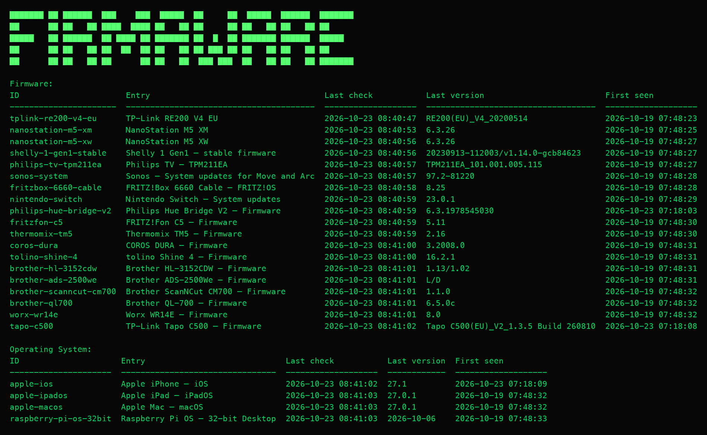
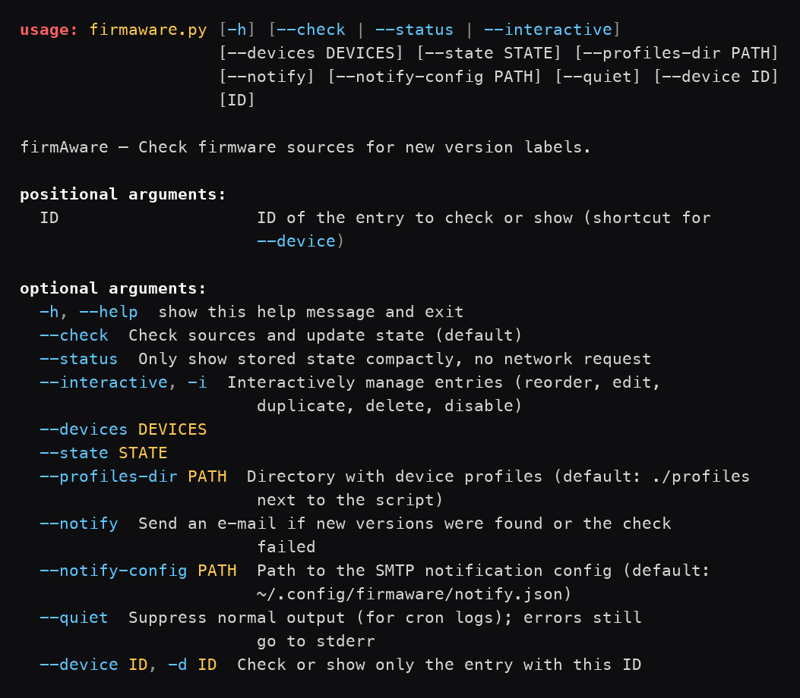

# firmAware

<a href="docs/firmAware_onepager.png"></a>

**firmAware** checks public firmware sources for configured devices and
reports previously unknown version labels in the terminal. Known versions are
stored locally, so each run only highlights new entries.

The application runs locally, requires **no dedicated cloud service**, and relies
**exclusively on the Python standard library** (no pip dependencies, no database).

> Note: firmAware observes published version lists. It does **not** check the
> firmware installed on a device and does **not** confirm that an update is
> available for a specific device.

**Visual overview:** [one-pager (German)](docs/firmAware_onepager.png)

## How it works

1. A source (HTML/text or JSON) is fetched for each device.
2. The published versions are extracted via a search pattern or a path.
3. The found versions are compared with the stored state.
4. New labels are reported; all known versions are retained.

On the first successful fetch, all detected versions are stored as the
**baseline** and are not yet reported as new.

## Requirements

- Python 3 (tested with Python 3.14)
- Internet access to the configured sources

## Quick start

Create your personal selection from the tracked template:

```bash
cp devices.template.json devices.json
```

`devices.json` is git-ignored, like `state.json`. The template ships one
example per entry form (a profile binding and a direct `text` source with a
placeholder URL) – replace them with your own entries, or use `--interactive`
to build the list in the terminal.

Standard run – check sources and update state:

```bash
python3 firmaware.py
python3 firmaware.py --check
```

Show stored state without a network request:

```bash
python3 firmaware.py --status
```



Manage entries interactively (arrow-key menu):

```bash
python3 firmaware.py --interactive
```

Custom file paths:

```bash
python3 firmaware.py --devices /path/devices.json --state /path/state.json
```

### CLI options

| Option | Meaning |
|---|---|
| `--check` | Check sources and update state (default) |
| `--status` | Only show stored state, no network request |
| `--interactive`, `-i` | Interactively manage entries (check, history, reorder, edit, duplicate, delete, disable) |
| `--devices PATH` | Path to `devices.json` (default: next to the script) |
| `--state PATH` | Path to `state.json` (default: next to the script) |
| `--profiles-dir PATH` | Directory with device profiles (default: `profiles` next to the script) |
| `--device ID`, `-d ID` | Check or show only the entry with this ID |
| `--notify` | Send an e-mail if new versions were found or the check failed |
| `--notify-config PATH` | Path to the SMTP config (default: `~/.config/firmaware/notify.json`) |
| `--quiet` | Suppress normal output (for cron logs); errors still go to stderr |

`--check`, `--status`, and `--interactive` are mutually exclusive.
Without arguments, `devices.json`, `state.json`, and `profiles/` are looked up
relative to the directory of the Python file – **not** relative to the current
working directory. An explicitly relative `--profiles-dir`, however, is resolved
relative to the current working directory.

A device ID can also be passed as a positional argument after `--check` or
`--status` (e. g. `python3 firmaware.py --check nanostation-m5-xm`).

Exit codes: `0` success, `1` configuration, check, or storage error,
`130` abort via `Ctrl+C`.



## Configuring devices

The configuration is split in two:

- `devices.json` describes the **personal device selection** and is git-ignored.
- `profiles/*.json` describe **reusable** fetch and version extraction.

A device is configured either directly or via a profile reference; both forms
may be mixed.

### Profile-based

```json
{
  "devices": [
    { "id": "coros-dura", "profile": "coros.dura" },
    { "id": "my-repeater", "profile": "tplink.re200-v4-eu", "name": "My Repeater" }
  ]
}
```

Profile-based entries may contain **only** the fields `id`, `profile`, `name`,
and `enabled`. Technical fields such as `source_url` are a configuration error
here.

### Direct

```json
{
  "devices": [
    {
      "id": "coros-dura",
      "name": "COROS DURA – Firmware",
      "source_type": "text",
      "source_url": "https://support.coros.com/hc/en-us/articles/32924317141652-COROS-DURA-Release-Notes",
      "version_pattern": "\\bV\\s*([0-9]+(?:\\.[0-9]+){2,3})\\b"
    }
  ]
}
```

## Device profiles

A profile corresponds to schema version `2`. The file name must match the
profile ID (`<id>.json`). Example `profiles/coros.dura.json`:

```json
{
  "schema_version": 2,
  "id": "coros.dura",
  "name": "COROS DURA – Firmware",
  "manufacturer": "COROS",
  "model": "DURA",
  "category": "firmware",
  "source_type": "text",
  "source_url": "https://support.coros.com/hc/en-us/articles/32924317141652-COROS-DURA-Release-Notes",
  "version_pattern": "\\bV\\s*([0-9]+(?:\\.[0-9]+){2,3})\\b"
}
```

Supported source types:

| `source_type` | Description | Required fields |
|---|---|---|
| `text` | Regex on HTML/text (after `html.unescape`) | `version_pattern` |
| `json` | Versions from a JSON list | `items_key`, `version_key` |
| `json_value` | Single value via a nested path | `value_path` |

For `version_pattern`, the following applies: without a capture group, the full
match is the version; with exactly one capture group, its content is; more than
one capture group is a configuration error.

Profile IDs must match the pattern `[a-z0-9][a-z0-9._-]*`. Profile files are
loaded exclusively from within the profiles directory; symlinks must not lead
outside the directory. Profiles contain **no** credentials and **no** runtime
state.

## Creating new profiles

Profiles are plain JSON files and are created **manually**, either by writing
`profiles/<id>.json` yourself or with the bundled `profileCreator` agent
(`.opencode/agents/profileCreator.md`), which walks you through the URL, the
version label, and the required fields and then writes the profile and the
matching `devices.json` entry.

Either way the file must follow the schema described above (`schema_version: 2`
with a `category` field). A profile-based entry in `devices.json` then needs
only `id`, `profile`, and optionally `name`/`enabled`:

```json
{ "id": "coros-dura", "profile": "coros.dura" }
```

FirmAware never fetches a source while you are creating a profile; you supply
the current version label yourself.

## Interactive entry manager

`--interactive` (`-i`) opens an arrow-key navigable list of all entries in
`devices.json`. Selecting an entry opens a submenu with these actions:

| Action | Description |
|---|---|
| Check now | Fetch the entry's source and show new versions; state is saved |
| Version history | List all known versions from `state.json`, sorted, with discovery timestamps and a `◄ newest` marker |
| Move up / Move down | Change the entry's position in `devices.json` |
| Edit name | Change the local display name (pre-filled with the current value) |
| Duplicate entry | Copy the entry with a new user-supplied ID |
| Delete entry | Remove the entry after confirmation |
| Disable / Enable | Toggle `enabled`; disabled entries are skipped during `--check` and marked `[off]` / `[disabled]` |
| Back to list | Return to the entry list |

Changes are written to `devices.json` only after the save prompt on exit;
discarding leaves the file untouched. Disabled entries are visible in the list
and in `--status` / `--check` but skipped by the actual check.

```bash
python3 firmaware.py --interactive
```

## State: `state.json`

`state.json` is your **private** runtime state. It is git-ignored and created
automatically by the first `--check` run; it is never committed. The repository
ships [`state.template.json`](state.template.json) with the empty structure for
reference.

```json
{
  "devices": {
    "nanostation-m5-xm": {
      "last_checked": "2026-10-15T07:17:54+02:00",
      "discovered_at": {
        "6.3.24": "2026-09-15T10:00:00+02:00",
        "6.3.26": "2026-10-15T07:17:54+02:00"
      }
    }
  }
}
```

- `last_checked`: time of the last **successful** check (local, with UTC offset).
- `discovered_at`: maps every recognized version to the timestamp when it was
  first discovered by a check.
- Versions that have disappeared from the source remain known.
- Storage is keyed by the **local** entry ID, not the profile ID. When
  switching to a profile, the same local version state is retained.

The `--status` output groups entries by category (Firmware, Software,
Operating System, Other) and shows an `ID` column per row, so the ID can be
copied for use with `--device`.

If `state.json` is missing, an empty state is used. The file is written
atomically via an adjacent `.tmp` file. `--status` prints
`No state yet: state.json does not exist. Run --check first.` to `stderr` when
the state file does not exist yet.

## Regular checks and email notifications

`--notify` sends a plain-text e-mail whenever the check finds new versions or
cannot complete. It is meant for unattended runs (e. g. a cron job on a
Raspberry Pi or NAS).

| Situation | Mail subject |
|---|---|
| New versions found | `firmAware: 2 new versions found` |
| Some entries failed, but the run finished | `firmAware: 1 warning` |
| Check aborted (config/storage error, crash) | `firmAware: check failed` |

A manual abort via `Ctrl+C` never sends a mail.

### SMTP configuration

Store your credentials **outside** the repository in
`~/.config/firmaware/notify.json`:

```json
{
  "smtp_host": "smtp.example.com",
  "smtp_port": 587,
  "smtp_security": "starttls",
  "smtp_user": "you@example.com",
  "smtp_password": "app-password",
  "mail_from": "you@example.com",
  "mail_to": ["you@example.com"]
}
```

- `smtp_security` is one of `starttls` (default, port 587), `ssl` (port 465),
  or `none`.
- `mail_to` may be a single address string or a list of addresses.
- `mail_from` defaults to `smtp_user`.
- `smtp_password` is optional (some relays need no authentication).

Protect the file:

```bash
mkdir -p ~/.config/firmaware && chmod 700 ~/.config/firmaware
chmod 600 ~/.config/firmaware/notify.json
```

`notify.json` is listed in `.gitignore` so it cannot be committed by accident.
Never put credentials in `devices.json`, `profiles/`, or any file in the
repository.

### Cron example

Run the check every morning and keep a log. `--quiet` suppresses the normal
output so the log stays small; errors still go to `stderr`:

```cron
0 8 * * * /usr/bin/python3 /home/pi/firmAware/firmaware.py --check --notify --quiet >> /home/pi/firmaware.log 2>&1
```

Use absolute paths (cron has a minimal `PATH`). The default `devices.json`,
`state.json`, and `profiles/` live next to the script, so the working directory
does not matter.

## Tests

Automated tests without network access (sources are replaced by test doubles):

```bash
python3 -m unittest discover -s tests -t .
```

## Project structure

```text
firmAware/
├── firmaware.py                              # fetch, extraction, comparison, profiles, CLI
├── devices.template.json                     # starting point: one example per entry form
├── devices.json                              # personal device selection (git-ignored)
├── profiles/                                 # reusable device profiles
│   └── *.json
├── state.template.json                       # empty state template (reference)
├── state.json                                # local runtime state (git-ignored, created on first --check)
├── tests/
│   └── test_firmaware.py                     # automated tests (standard library only)
├── docs/                                     # screenshots used in this README
│   ├── cli-help.png                          # rendered --help output
│   ├── status-table.png                      # rendered --status output
│   └── firmAware_onepager.png                # visual one-pager (German)
├── .gitignore                                # ignores devices.json, state.json, notify.json, build artifacts
└── requirements/
    ├── specification.md                      # project specification
    └── firmAware-requirement-geraeteprofile.md
```

## Limitations

- No automatic scheduling and no long-running background service (scheduling is left to cron or a similar tool).
- Email notification is opt-in via `--notify` and needs an external SMTP relay; no push or MQTT notifications.
- No semantic version comparison ("higher/lower") for upgrade decisions; the
  displayed "Last version" is the highest detected label using a best-effort
  numeric sort, not a guarantee that an update is available.
- No detection of installed device firmware and no automatic installation.
- No JavaScript execution, authentication, pagination, or bypassing of HTTP
  blocks (e.g. HTTP 403).
- No distinction between beta and stable unless the source itself is limited.
- No guaranteed long-term stability of manufacturer endpoints.
- URLs and search patterns are considered trusted local configuration and are
  not intended for unverified public input.
- No file locking; concurrent invocations using the same state file are not
  supported.

Further details are available in [`requirements/specification.md`](requirements/specification.md).
